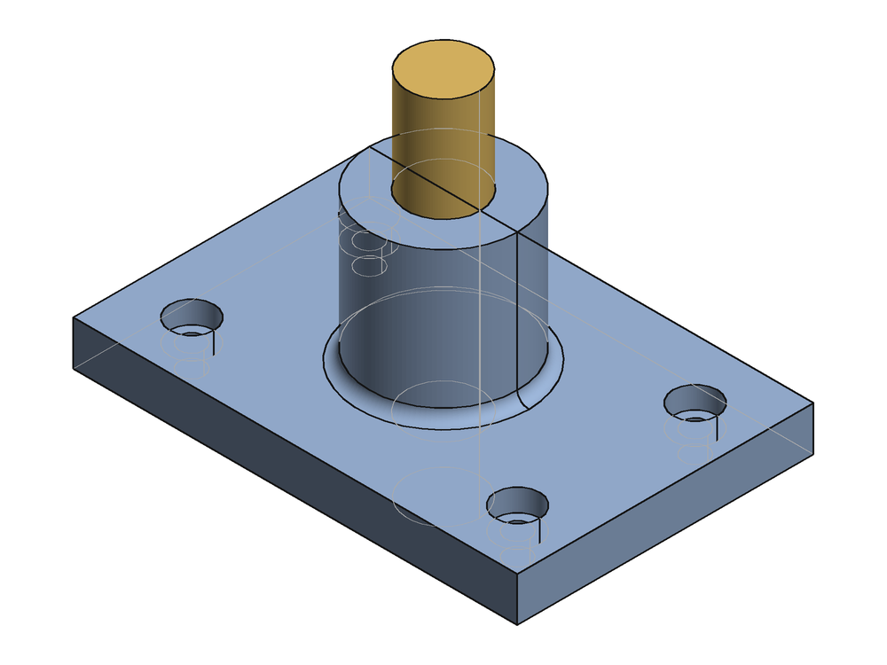
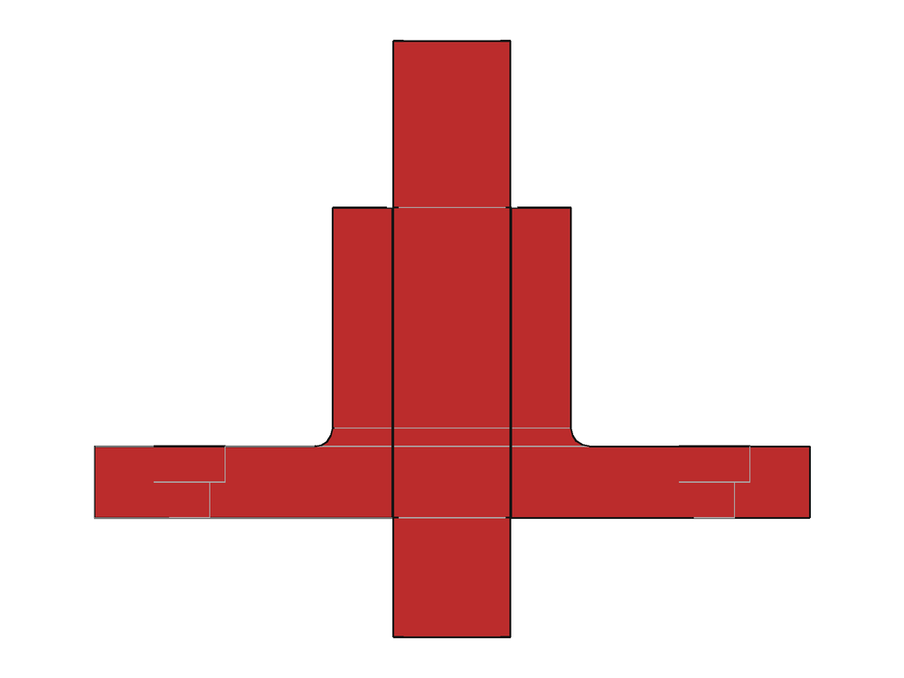
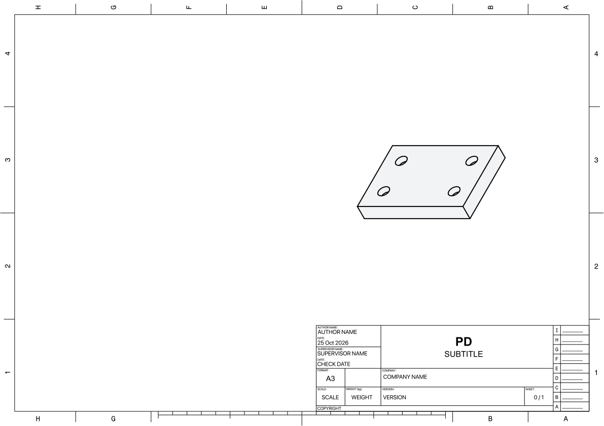

# FreeCAD MCP — design

Status: **M0–M5 built** (M5: FEA with CalculiX) (core loop, verification, Assembly workbench, drawings, manufacturability, release, plugin packaging, reload helper, evals, hardening from eval runs) — 1,205 end-to-end checks pass (§11, §13) · 2026-10-27 · FreeCAD 1.1.4 on macOS

An MCP server that lets Claude (in Cowork, Claude Desktop or Claude Code) take a
design brief, reference drawings and part datasheets and turn them into
verified, manufacturable FreeCAD models, drawings and exports — iterating on
numeric evidence, not on screenshots alone.

---

## 1. Principles

1. **Code in, evidence out.** Claude writes FreeCAD Python, which it does well.
   The server runs that code safely and sends back detailed, structured
   results: validity, feature errors, sketch status, mass, sections,
   clearances, alignments and renders. It does not offer dozens of
   object-editing tools.
2. **The script is the source of truth for new designs.** Each build runs
   `model.py` against an empty document, so results are reproducible and
   diffable, and errors from earlier edits never pile up. Existing user models
   are changed with *patch scripts* that save a new revision.
3. **Headless first; the GUI is just for viewing.** There's no addon to install
   and no "Start RPC server" button. FreeCAD's GUI is only for the user to look
   at results (or for drawing export, §4.3).
4. **Numbers before pictures.** Every check returns values in mm with pass/fail.
   Images are there to orient Claude and the user, not to prove anything.
5. **Zero dependencies.** The server runs on FreeCAD's bundled Python 3.11,
   which already includes numpy, matplotlib, PIL and PySide6.
6. **Few tools, a rich helper library.** About 18 tools, plus an `fclib` module
   available inside scripts for the error-prone parts of FreeCAD's API (holes,
   threads, attachment, constraints, standards).

---

## 2. What we learned

### 2.1 Your OpenSCAD MCP (`~/Development/Projects/openSCAD MCP`)

Keep almost all of its structure:

- one stdlib-only file speaking JSON-RPC over stdio, with no build step
- each request handled on its own thread, so a long render doesn't block other tools
- background jobs (`wait: false`) plus a status tool
- child processes killed on `notifications/cancelled` and on shutdown
- guard rails: text-only writes, `.bak` on overwrite, unique-match edits, a
  roots allow-list
- named camera presets, and a geometry-health line in every render result
  (OpenSCAD's manifold report becomes FreeCAD's `isValid` / feature status)
- smoke tests that drive the real server over stdio

### 2.2 neka-nat/freecad-mcp

**How it works.** An addon runs an XML-RPC server inside the FreeCAD GUI. A
FastMCP process (started with `uvx`) relays tool calls to it. Its 17 tools are
object create/edit/delete, `execute_code` (on the GUI thread), async and
headless execution, screenshots, a parts library, and FEM through CalculiX.

**What to borrow:**
- headless `freecadcmd` execution, so an OCCT crash (common in threads, sweeps
  and lofts) doesn't take the GUI down
- classifying crashes (killed by signal vs FreeCAD's own "Program received
  signal" message)
- keeping screenshots to 1024 px or less, because image size is what costs tokens
- FEM is possible later: `ccx` and `gmsh` ship inside FreeCAD.app

**What to avoid for our goals:**
- **It needs the GUI running and a manual "Start RPC" click.** Much of its
  code deals with GUI-thread dispatch, queue and execution timeouts, recovering
  a stuck GUI, and blank screenshots on macOS when the window is covered.
- **Its feedback is shallow:** volume, area and face/edge counts, plus a
  screenshot. It has no sections, clearances, alignment checks, hole data,
  sketch DoF or feature error messages.
- **Object-edit tools invite imperative, stateful edits.** Over many calls the
  model and Claude's picture of it drift apart.

### 2.3 Spike results on this Mac

| Capability | Result |
|---|---|
| Console run (start, build, check, export STEP, exit) | **0.3 s** in total |
| `import FreeCAD` from the bundled `Resources/bin/python` (plus `sys.path.append(Resources/lib)`) | works, with clean stdout and no banner noise |
| `isValid`, volume, centre of mass, inertia, `slice`, `common` (interference), `distToShape` | all work headless, each in milliseconds |
| PartDesign Body, Sketch, Pad and Hole, headless | work. Hole knows ISO metric threads (`M3x0.5`…), cut types including ISO 4762, 10642 and 7089 heads, and computes the tap drill itself |
| Modelled threads | work but are slow: 4 × M3 took about 13 s → **cosmetic threads by default** |
| Sketch diagnostics | `DoF`, `FullyConstrained`, `Conflicting`/`Redundant`/`MalformedConstraints` |
| Feature errors | `State == ['Invalid']` and `getStatusString()` give e.g. "BRep_API: command not done". **`Body.Shape` quietly stays at the last good feature and still reports valid**, so the report must list feature status |
| Hole defaults | `ThreadClass` defaults to `4G` (the first enum value), so fclib must set `6H` |
| FreeCAD's own 3D view, without a visible window | `offscreen` and `minimal` Qt platforms segfault; a covered Cocoa window saves a blank PNG → not usable |
| Coin3D `SoOffscreenRenderer` in console mode | fails (no CGL pbuffer) |
| **Own renderer**: tessellate, numpy z-buffer, PIL, with exact BREP edges drawn on top | **works in 0.3–0.9 s at 1000 × 750** — see image below |
| TechDraw in console mode | pages, views and dimensions compute (the dimension value is correct), but export needs `TechDrawGui`, which won't load in console |
| TechDraw export via the GUI binary | works with a real window shown briefly, about 5–8 s. Views created in console mode come out blank; views created in the GUI process render → **all drawing work runs in a GUI-mode worker** |
| `/usr/bin/python3` | blocked by the Xcode licence on this machine → don't depend on it |
| **M0** TechDraw page built entirely in the GUI process | works: first-angle projection group (front/top/right), a dimension on **3D** geometry (`References3D`, value 60.0), a diameter on a view edge, a note and a section view all export to PDF. Views compute asynchronously, so the worker must poll `getVisibleEdges()` until every view has geometry before exporting. Hand-placed items overlap → the `drawing` tool needs auto-layout plus a preview check |
| **M0** renderer at scale | single parts 0.2–0.3 s. A 24-part assembly with 960 holes (146k triangles) renders in 3.3 s at 1024 px, after switching to `MeshPart` tessellation with an angular limit and batching triangles by screen size. Silhouettes come from depth/object discontinuities, hidden cylinder outlines are computed per view, and section caps are hatched |
| **M0** Cowork plugin launch | not testable here (no Claude CLI on this machine) → verify in the desktop app during M4 |

| Headless render (prototype) | Section render (prototype) | TechDraw export via GUI worker |
|---|---|---|
|  |  |  |

The section image shows why sections must report numbers. The shaft
(Ø9.8 mm) has a 0.1 mm gap to its Ø10 mm bore, which can't be seen at this
scale. The prototype also caps every body in the same red; the real version
will give each body its own colour. Prototype code: `spikes/render_prototype.py`.

---

## 3. The design process this server supports

```
 brief, drawings, datasheets
          │
  ① intake ──▶ ② requirements.md + checks.json ──(user confirms key numbers)
          │
  ③ reference parts (datasheet envelopes / vendor STEP, with named frames)
          │
  ④ layout: datums, frames, envelope ──▶ render + check_fit
          │
  ⑤ detail model (model.py) ◀──────────────┐
          │                                 │
  ⑥ verify: build report → checks.json →    │ ⑦ iterate
     section / check_fit / measure / DFM ───┘   (params first, then features)
          │ all green
  ⑧ document: TechDraw drawing (new or annotate existing)
          │
  ⑨ release: STEP / STL / 3MF / DXF / PDF + verification report
```

| Stage | What Claude does | Tools | Gate |
|---|---|---|---|
| ① Intake | Reads the brief, reference drawings and datasheets natively (vision/PDF). Identifies interfaces, envelope, process and material. Asks about gaps. | `create_project` | — |
| ② Requirements | Writes `requirements.md` with every number cited (`[motor.pdf p2]`), `params.json` (value, unit, source) and `checks.json` (acceptance criteria). | file tools, `lookup_standard` | **User confirms the key dimensions** |
| ③ Reference parts | Models bought-out parts as simplified envelopes that keep the true interface geometry (hole pattern, shaft, pilot, connector keep-outs), or imports the vendor STEP. Adds named frames to them. | `build`, `inspect`, `render` | Interface dims match the datasheet (`measure`) |
| ④ Layout | Places reference parts and defines datums and frames. Checks the envelope. | `build`, `render`, `check_fit` | Envelope OK |
| ⑤ Model | Builds PartDesign bodies from fully constrained sketches, with dimensions taken from interfaces and datums, and holes from standards. | `edit_file`, `build` | Build is all ✓ |
| ⑥ Verify | Every build: report plus `checks.json`. Deeper checks: sections through every interface, a fit matrix, hole-pattern and coaxial alignment, DFM for the process. | `section`, `check_fit`, `measure` | All checks pass |
| ⑦ Iterate | Tries a parameter change first; changes features only if needed. Can try variants. Compares to the previous revision. | `build(params=…, variant=…)` | — |
| ⑧ Document | Makes a new drawing or annotates an existing one: views, sections, dimensions, hole/thread callouts, notes, title block. | `drawing` | Preview reviewed |
| ⑨ Release | Exports files and writes a verification report: requirement → evidence. | `export` | — |

---

## 4. Architecture

```
 Claude (Cowork · Desktop · Code)
        │  MCP over stdio (JSON-RPC, one thread per request)
 ┌──────▼────────────────────────────────────────────────┐
 │ freecad_mcp.py  — stdlib only, never imports FreeCAD  │
 │ project/file tools · job table · child-process mgmt   │
 └──────┬──────────────────────────────────┬─────────────┘
        │ spawn per call / per job          │ spawn (drawings only)
 ┌──────▼────────────────────────┐   ┌─────▼──────────────────────────┐
 │ console worker                │   │ GUI worker                     │
 │ bundled python -I worker.py   │   │ FreeCAD.app + worker_gui.py    │
 │ FreeCAD, Part, PartDesign,    │   │ TechDraw create/edit/export    │
 │ Sketcher + fclib + render     │   │ (window visible ~5–10 s)       │
 └──────┬────────────────────────┘   └─────┬──────────────────────────┘
        └──────────── project folder ──────┘
                 model.py params.json checks.json
                 build/*.FCStd  out/*.png|step|stl|pdf  .history/
                          ▲
                 FreeCAD GUI (optional viewer · open_in_gui · reload macro)
```

### 4.1 Process model

- **One process per call.** Startup is 0.3 s, so there's little to gain from
  keeping a worker alive. An OCCT segfault only kills that one worker. No state
  carries between calls, which fits the script-first model, and calls can run
  in parallel. A pre-warmed worker pool can come later if latency matters.
- **Server ↔ worker protocol:** a request JSON goes in a temp file. The worker
  writes a result JSON and any image files. stdout and stderr are captured as
  the log. Exit status is classified as `ok`, `script error` (traceback),
  `crash` (signal, or FreeCAD's backtrace message) or `timeout`.
- **Long operations** (modelled threads, big booleans, drawings) use
  `wait: false` and `job_status`, the same pattern as the OpenSCAD MCP.
  Cancelling kills the child.
- **The interpreter** is FreeCAD's bundled `python`. The server locates
  `FreeCAD*.app` (or uses `FREECAD_APP`) and adds `Resources/lib` to `sys.path`
  in the worker. The server itself also runs on that interpreter, so FreeCAD is
  the only thing to install.

### 4.2 Safety

- `FREECAD_MCP_ROOTS` allow-list; writes limited to text extensions; `.bak` on
  every overwrite or edit.
- `build` won't overwrite an `.FCStd` that was modified after the last build
  (the user edited it in the GUI) unless `force: true`. It reports which objects
  differ.
- Patch scripts on a user's own `.FCStd` never write in place. They save to
  `<name>.rNN.FCStd`, or in place with a `.bak` only when asked.

### 4.3 Drawings need the GUI binary

TechDraw export can only run inside the GUI process. The drawing worker starts
`FreeCAD.app` with a script, creates or edits pages there, opens the page view,
exports PDF/SVG/DXF and a PNG preview, saves, and exits. The FreeCAD window is
visible for about 5–10 s per call. If that becomes annoying, the fallback is to
compose drawings ourselves from `TechDraw.viewPartAsSvg` plus our own dimension
SVG. That export would work headless but would not be an editable TechDraw page.

---

## 5. Project layout

```
~/CAD/<project>/
  project.json        units, process, material + density, drawing standard,
                      default clearances, title-block fields, export list
  requirements.md     extracted requirements, each with its source
  params.json         {"motor_pcd": {"value": 31.0, "unit": "mm",
                        "source": "NEMA17 datasheet p2"}, ...}
  model.py            build script — the source of truth
  checks.json         acceptance checks, evaluated on every build
  refs/               datasheets, reference drawings, vendor STEP
  build/<project>.FCStd   generated; parametric (Params spreadsheet + Bodies)
  out/                renders, sections, exports, drawings
  .history/r0007/     model.py, params.json, report.json snapshot per build
```

Parameters are written into a `Params` spreadsheet with aliases, and features
reference them through expressions. The generated `.FCStd` therefore stays
editable in the GUI as a normal parametric model.

```python
# model.py — runs inside the console worker with `fc` (fclib) preloaded
P = fc.params()                                  # params.json → Params sheet
motor = fc.ref_part("Motor", step="refs/nema17.step",
                    frames={"mount": fc.frame(0, 0, 0, normal="+Z")})
body  = fc.body("Bracket")
base  = fc.pad(body, fc.sketch(body, "XY", fc.rrect(P.w, P.d, r=P.corner)),
               P.t)
fc.holes(body, on=fc.face(base, "+Z"), at=fc.rect_pattern(31, 31),
         spec="M3 clearance normal + cbore ISO4762")
fc.holes(body, on=fc.face(base, "+Z"), at=[(-25, 15), (25, 15)],
         spec="Ø5.6", depth=6)                     # heat-set insert hole (vendor datasheet)
fc.mate(motor, "mount", fc.frame_on(fc.face(base, "-Z")), mode="against")
```

---

## 6. Tools

| # | Tool | Purpose | Key inputs → returns |
|---|---|---|---|
| 1 | `freecad_status` | Environment health | → FreeCAD path and version, worker check, home dir, roots, GUI running, jobs |
| 2 | `guide` | The playbook (fallback when the skill isn't installed) | `topic?` → markdown |
| 3 | `create_project` | Scaffold §5 | `name, template: part\|assembly\|existing, process, material` → files |
| 4 | `read_file` | Read a text file with line numbers | path, line range |
| 5 | `write_file` | Create or overwrite (`.bak`) | path, content, overwrite |
| 6 | `edit_file` | Exact unique-match replace (`.bak`) | path, old, new, replace_all |
| 7 | **`build`** | Run `model.py` and save the `.FCStd` → **build report** (§7.1) plus an iso render | `project, params?, variant?, views?, wait?` |
| 8 | `run_script` | Run any FreeCAD Python against a doc or STEP (patch or query) | `code, doc?, save: no\|revision\|inplace` → stdout, `fc.result(...)` data, change summary |
| 9 | `inspect` | Model tree and geometry index | `doc, object?, level: summary\|object\|sketch\|params` (§7.2) |
| 10 | `render` | Headless images (§7.3) | `doc, views[], objects?, highlight?, style: shaded\|xray\|drawing, section?, scale?` → one PNG grid |
| 11 | `section` | 2D cross-section with gap analysis (§7.4) | `doc, plane, objects?` → PNG + per-body areas, pairwise min gaps with locations |
| 12 | `check_fit` | Interference/clearance matrix (§7.5) | `doc, objects?, min_clearance?` → pairs table + highlight render |
| 13 | `measure` | Distance, angle, alignment, pattern match (§7.6) | `doc, queries[{a, b?, what?}]` |
| 14 | `lookup_standard` | Holes, threads, fasteners, inserts, fits (§9) | `kind, size, …` → dimensions with source |
| 15 | `drawing` | TechDraw read, create, annotate, export (§7.7) | `doc, page?, ops[]?, export?` → inventory + preview PNG + files |
| 16 | `export` | STEP, STL, 3MF, BREP, IGES, OBJ; DXF/SVG for sections and projections | `doc, objects, format, tolerance?` |
| 17 | `open_in_gui` | Open the file in FreeCAD, launching it if needed | `path` |
| 18 | `job_status` | Poll or collect background work | `job_id?, wait_seconds?` |

Every tool that takes `doc` accepts `.FCStd`, `.step`/`.stp`, `.brep` or
`.stl`, so a vendor STEP can be inspected or rendered without importing it
first.

### 6.1 Geometry references (used by measure, section, check_fit, checks, drawing)

```
Bracket                     an object (Label or Name)
Bracket.Face6 / .Edge3      a sub-element — only stable within one revision
Bracket.face(+Z)            the outermost planar face facing +Z; face(+Z, z=8)
Bracket.holes               every detected hole; .holes[2]; .holes(d=3.4)
Motor.frame(mount)          a named frame (LCS) defined with fc.frame
[10, 20, 0]                 a point;  plane(z=8)  axis([x,y,z],[dx,dy,dz])
```

The playbook tells Claude to prefer the semantic forms (`face(…)`, `holes`,
`frame(…)`), because FreeCAD's `FaceN` numbering changes when the model changes
(the toponaming problem).

---

## 7. Outputs

### 7.1 Build report

The most important output. It is text first, with JSON kept in `.history/`.

```
BUILD ✗  bracket  r0008  1.6 s          (1 error · 1 warning · 1 check failed)
params   t=6 (was 5) · motor_pcd=31 · corner=3
objects
  Bracket  Body   solid ✓ valid ✓   18 725 mm³  23.2 g PETG   bbox 60×40×26
    Pad ✓  Pocket ✓  M3Holes ✓ (4× M3 clr ISO273-normal Ø3.4, cbore Ø6.5↧3.3)
    Fillet ✗  "BRep_API: command not done"  → Body is showing Pocket, not Fillet
  Motor    ref (STEP)                bbox 42.3×42.3×48
sketches  Base 0 DoF ✓ · HolePts 8 DoF ⚠ under-constrained
checks
  ✓ motor-clearance   Bracket↔Motor ≥ 0.30   → 0.52 mm
  ✓ motor-pattern     max offset ≤ 0.05      → 0.00 mm
  ✗ wall-min          ≥ 2.0                  → 1.6 mm at (12.0, 3.1, 4.0)
Δ r0007   volume +4.2 % · bbox z 24 → 26
log       1 warning: "Sketch HolePts: 8 degrees of freedom"
image     out/bracket_iso.png  [inline]
```

### 7.2 inspect

- **summary** — object tree, type, label, visibility, placement, and per-object
  validity, volume, mass and bbox.
- **object** — a geometry index Claude can refer to:
  `Face6 plane +Z z=8.0 area 2400 (top)`,
  `Face9 cylinder r=1.7 axis +Z at (10,10) concave → hole`, and so on. Also a
  holes table (diameter, axis, depth, through/blind, counterbore, thread from
  the Hole feature), named frames, and expressions bound to parameters.
- **sketch** — geometry, constraints, DoF, and conflicting/redundant
  constraints.
- **params** — spreadsheet aliases with their values and the expressions that
  use them.

### 7.3 render

- Our own headless renderer: shaded faces, crisp BREP edges, faint hidden
  edges. Multiple views come back as **one labelled grid image** (iso, front,
  top, right) to save tokens. Long edge 1024 px or less by default.
- Each view gets an axis triad, a scale bar and object labels.
- Styles: `shaded`; `xray` (transparent, so internal features show); and
  `drawing` (black visible lines, dashed hidden lines, orthographic at a stated
  px/mm) for comparing against the user's reference drawing.
- `highlight`: objects, faces or holes in a contrast colour. `section`: cut and
  cap, with each body's cap in its own colour.

### 7.4 section

- `plane`: `{z: 12}`, `{x: 0}` or `{point, normal}`; optional `objects`.
- Image: a 2D plot with each body hatched in its own colour, a mm grid, and the
  minimum gap between bodies labelled.
- Data: section area and bbox per body, and for each pair of bodies the minimum
  in-plane gap with its location. Negative means overlap, with the overlap area.

### 7.5 check_fit

For every pair of solids (or the listed ones): interference volume, minimum
distance with the closest points and the faces they're on, and pass/fail
against `min_clearance` (default from `project.json`). Pairs that are meant to
touch (threads, press fits, contact faces) can be marked `expected`. Returns a
render with interferences in red.

### 7.6 measure

The comparison depends on what `a` and `b` are:

| a ↔ b | Result |
|---|---|
| point/vertex ↔ anything | distance and closest point |
| plane ↔ plane | angle and distance (parallel / coplanar verdict) |
| axis ↔ axis (holes, shafts, cylinders) | coaxial offset and angle |
| holes ↔ holes (patterns) | best pairing, per-hole offset, max offset, diameter comparison |
| frame ↔ frame | translation and rotation delta |
| object alone | bbox, volume, centre of mass, mass |

### 7.7 drawing

- **read**: pages, template fields, views (type, direction, scale, position),
  dimensions with their values and references, annotations, and a page preview
  PNG.
- **ops**: `add_view`, `add_projection_group`, `add_section_view`,
  `add_detail_view`, `add_dimension` (references the **3D** geometry using §6.1,
  mapped to TechDraw `References3D`), `add_hole_callout` (built from Hole
  feature data, e.g. `4× M3×0.5-6H THRU`, or `⌴ Ø6.5 ↧ 3.3` for a
  counterbore), `add_note`, `add_balloon`, `set_title_block`, `move`, `remove`.
- **export**: PDF, SVG, DXF and a PNG preview, always returned inline so Claude
  can check the layout.
- The playbook's default for existing drawings: add, never move or remove.
- **create** (backlog round): pockets, slots, steps and cut-outs are detected
  (`drawing_support.detect_pockets`) and dimensioned — size, location from the
  hole datums, depth (side view or "↧" callout), corner radii, shared callouts
  for identical pockets; turned parts with a bore get SECTION A-A (a
  `DrawViewSection` through the axis) with per-bore Ø and depths; bent sheet
  parts get a bend table and a flat-pattern view from `fc.sheet_flat`. Pockets,
  K-factor and bends are part of the sheet's content fingerprint, so a moved
  pocket makes a saved sheet stale. Details: `skills/…/references/drawings.md`.

---

## 8. fclib — the helper library inside scripts

Wrappers only where raw FreeCAD is error-prone; everything else is plain FreeCAD.

| Area | API (draft) |
|---|---|
| Parameters | `fc.params()` → attribute access, synced to the `Params` sheet with expressions |
| Sketch profiles (fully constrained) | `fc.sketch(body, plane_or_face, *profiles)`, `fc.rect`, `fc.rrect`, `fc.circle`, `fc.slot`, `fc.polygon`, `fc.points` |
| Features | `fc.pad`, `fc.pocket`, `fc.revolve`, `fc.fillet(edges_selector, r)`, `fc.chamfer` — thin, with readable errors |
| Selectors | `fc.face(obj, "+Z", z=…)`, `fc.edges(obj, on=face, kind="circle", r=…)` |
| Holes and threads | `fc.holes(body, on, at, spec, depth)` → PartDesign::Hole with the right enums (6H, ISO 273 fits, head types); `fc.thread(...)` cosmetic or modelled external threads |
| Patterns | `fc.bolt_circle(pcd, n, start)`, `fc.grid(nx, ny, px, py)`, `fc.mirror_pts` |
| Reference parts | `fc.ref_part(name, step=… or envelope=…, frames=…)` — bought-out parts, excluded from mass |
| Frames and mates | `fc.frame(x, y, z, normal, xdir)`, `fc.frame_on(face, at)`, `fc.mate(part, frame, target_placement \| obj, target_frame, mode='against'\|'aligned', offset, rotate)` |
| Standards | `fc.std.*` — the same tables as `lookup_standard` |
| Results | `fc.result(**data)` — structured return from `run_script` |

---

## 9. Standards data

JSON tables shipped with the server, each with its source, used by both
`lookup_standard` and `fclib`. Claude is told to look them up rather than
recall from memory.

- ISO 273 clearance holes (fine, medium, coarse), M1.6–M24
- ISO 261/724 metric threads: pitch, tap drill, minor diameter
- ISO 4762 / 7380 / 10642 head dimensions → counterbore and countersink dimensions
- ISO 4032 nuts (nut traps), ISO 7089 washers
- Heat-set inserts (common vendor dimensions, flagged as vendor-specific)
- ISO 286 fits for common sizes (H7/g6, H7/h6, H7/k6, H7/p6) with limits
- Process defaults in `project.json`: FDM hole compensation, sliding and press
  allowances, minimum wall, max overhang angle; CNC minimum internal radius;
  laser kerf

---

## 10. Where the prompt lives

Several layers, all from one source, `skills/freecad-design/SKILL.md` (plus
its `references/` pages):

| Layer | Seen when | Contents |
|---|---|---|
| Tool descriptions | Always, by any client | What each tool returns and when to use it |
| MCP `instructions` (initialize) | Clients that honour it (Claude Code, likely Desktop) | ~10 lines: the core loop + "call `guide` first" → `prompt/server_instructions.md` |
| `guide` tool | Any client, on demand | The full playbook (same text as the skill); `guide(topic="fclib")` etc. serves a reference page |
| **Plugin skill** `freecad-design` | Automatically, for CAD tasks in Cowork and Claude Code | The playbook → `skills/freecad-design/SKILL.md`, with `references/` (fclib API generated from docstrings, checks, processes, troubleshooting) |
| Plugin commands | When the user types them | `/freecad-design:new-part`, `check`, `drawing`, `release` → `plugin/commands/` |
| Cowork project instructions | Every task in that project | Project-specific facts only (process, material, standard, title block) → `prompt/project_instructions_template.md` |

**Packaging for Cowork: a plugin.** Anthropic's plugin docs confirm that a
plugin can bundle a **local MCP server** (a command the app starts, including
`.mcpb` bundles) with skills and commands. The server "loads when the Cowork
session runs on your computer"; chat ignores it.

`tools/build_plugin.py` builds and validates it (`dist/freecad-design.zip`,
one top folder, executable bits kept):

```
freecad-design/
  .claude-plugin/plugin.json   name, version (= SERVER_VERSION), author, licence
  .mcp.json            {"mcpServers": {"freecad": {"command": "/bin/sh",
                          "args": ["${CLAUDE_PLUGIN_ROOT}/server/launch.sh"]}}}
  server/              launch.sh (finds FreeCAD's bundled python), freecad_mcp.py, worker.py,
                       drawing_worker.py, fclib.py, analysis.py, render.py, manufacture.py, standards.py
  skills/freecad-design/SKILL.md + references/
  commands/            new-part.md, check.md, drawing.md, release.md
  freecad_addon/       FreeCADMCPReload/ (addon) + MCP_Reload.FCMacro
  evals/               the cases as a `claude plugin eval` suite
  evals_harness/       cases.json, fixtures, mcp_cli.py, run_case.py
```

It also writes `dist/freecad-mcp.mcpb` (manifest 0.3, server only, with a
`projects_dir` setting) for clients that take MCP bundles. No top-level
`bin/` directory: it stops Cowork from installing the plugin. No
`user_config` in the plugin either: Cowork skips a server whose config
references one without a default. The fallback that is known to work is an
entry in `claude_desktop_config.json`, as with the OpenSCAD MCP, plus the
skill uploaded on its own.

**Where does the server run?** Cowork may run plugin servers on the Mac or in
its VM. `freecad_status` reports `host` (platform, machine, plugin root), so
the first call shows which; in a VM there is no FreeCAD, and the status
message points to the manual config.

**Live view: MCP Reload.** A small FreeCAD addon (`freecad_addon/`), installed
by `open_in_gui(install_reload_helper=true)` only with the user's OK. A
`QTimer` polls the files of open documents; when one changes on disk (and has
settled for 0.6 s) it closes and reopens it, keeping the camera, the active
document and the view in front. A document with unsaved user edits is never
reloaded: a document observer marks a document edited when objects change,
are created or deleted after it was loaded or saved (Python-console and macro
edits included; transactions in progress, read-only/output properties and
TechDraw's own post-load geometry rewrites are ignored), with `Modified` as
the signal when undo is off. The report view then says to close it *without
saving* (or File ▸ Revert) — saving would overwrite the rebuild. No reload
happens in edit mode, with a task panel open or under a modal dialog; it
waits. Documents already stale when the watcher starts (Document.xml's
LastModifiedDate differs) are reloaded too, unless FreeCAD already marked
them modified (they count as unsaved until saved or reverted); Save a Copy
does not clear the edited mark. FreeCAD's own saves are ignored,
and the watcher is inert inside the server's own FreeCAD processes. It
imports Qt through FreeCAD's `PySide` shim (Qt5 and Qt6 builds), prints
"watching N open document(s)" at start, and `MCP_Reload.FCMacro` (installed
in FreeCAD's macro folder) toggles it.

**Cowork paths.** Claude's own file tools in Cowork work on a mounted copy of
the user's folder inside a VM, while the MCP server runs on the Mac. Tools
therefore take **project-relative paths** (`project` + relative path),
always return images inline, and include the file tools themselves, so the
workflow never depends on path mapping.

---

## 11. Phases

| Phase | Scope | Status |
|---|---|---|
| **M0 spikes** | (a) GUI drawing worker (b) Cowork plugin launch (c) renderer at assembly scale | (a) ✓ works, with the HLR-wait and layout caveats in §2.3. (c) ✓ 3.3 s for 146k triangles. (b) moved to M4: needs the desktop app |
| **M1 core loop** | server, worker protocol, `freecad_status`, `guide`, `create_project`, `list_projects`, file tools, `build` + report + history/Δ, `run_script`, `inspect`, `render`, `job_status`, `open_in_gui`; fclib params, sketch profiles, pad/pocket/fillet/chamfer, selectors, holes, ref parts, frames, mates, patterns | ✓ built. 50 stdio checks pass against real FreeCAD (`tests/smoke_test.py`, ~19 s). `examples/nema17_bracket` builds ✓ in 0.2 s |
| **M2 verification** | `section`, `check_fit`, `measure`, `lookup_standard` + tables (insert / nut-trap / fit hole specs), `checks.json` evaluated in the build report, GUI-edit detection + `adopt_gui_params` | ✓ built. `tests/test_m2.py`: 56 checks against geometry with known answers (500 mm³ overlap, 2.0 gap, 0.1 radial gap, 0.03 pattern offset, contact with a 0.42 nearest gap, container and link placements), ~15 s. The NEMA17 example passes 5/5 acceptance checks |
| **M3 drawings, export, release** | `drawing` create/read/edit via the GUI worker; `export` with verification; `check_manufacturing` (FDM/SLA, CNC, turning, laser); `release` package; turned parts (`fc.turned`, fits, threads) | ✓ built. `tests/test_m3.py`: 37 checks, ~70 s. Examples `nema17_bracket` (FDM) and `turned_shaft` (turning) release end to end |
| **M2b assemblies** | fclib helpers for the Assembly workbench: `fc.assembly`, `fc.add`, `fc.ground`, `fc.joint(kind, (part, frame), (part, frame), mode)`, `fc.solve` with per-joint verification | ✓ built. Joints reference whole parts with the named frame as the joint offset (no element names). The solver accepts parallel or anti-parallel axes and returns the solution nearest the start, so parts are pre-placed at the joint before solving, and every joint is re-measured afterwards ("holds ✓" / "off by …") |
| **M4 package, reload, evals** | Cowork/Claude Code plugin + `.mcpb`, MCP Reload addon and macro, eval cases + harness + `claude plugin eval` suite; then a hardening round from the eval runs and an adversarial review (§13) | ✓ built. 14 eval cases; 1,013 stdio checks across 11 suites pass |
| **M5 analysis** | FEM via CalculiX: material, fixtures, loads, mesh, solve → max von Mises, displacement, safety factor | ✓ built. `analyze` tool + `server/fea.py`: supports/loads on faces and holes (geometry references), forces, pressures, self weight; gmsh tet10 + CalculiX (bundled, ~2 s for a small part); results with location, stress away from supports, safety factor, reactions vs applied load, refined-mesh convergence; load cases in `fea.json`; `fea_safety`/`fea_stress`/`fea_displacement` checks, stale on geometry or case change, re-solved by release. Backlog round: natural frequencies and linear buckling (`fea_frequency`, `fea_buckling`), several parts bonded with CalculiX `*TIE` (FreeCAD's tie constraint tied coincident faces to themselves, so fea.py writes the input deck itself from gmsh's per-face groups and reads results with numpy), and ~7× faster solves (refined solve only for small meshes; the eval shelf bracket 150 s → 20 s). `tests/test_m5.py` checks a cantilever against beam theory (tip 0.581 mm vs 0.581–0.585; root 60 MPa), a uniform load (0.2177 mm exact), self weight, bolted holes, errors, stale checks and release |

### Implementation map

| File | Role |
|---|---|
| `server/freecad_mcp.py` | MCP server: stdlib only, never imports FreeCAD. Tools, paths, jobs, cancellation, worker spawning |
| `server/worker.py` | One request per FreeCAD process: `probe`, `build` (report, history, Δ, overwrite guard), `run_script`, `inspect` (geometry index, hole detection), `render` |
| `server/fclib.py` | `fc` inside scripts: params ↔ spreadsheet binding, fully constrained profiles, features, selectors, holes, ref parts, frames, mates, patterns |
| `server/render.py` | Headless renderer: vectorised z-buffer, BREP edges, silhouettes, hidden lines, sections with hatching, view grids; highlighted items over wireframe context |
| `server/analysis.py` | Worker side: introspection in global coordinates (containers, links), hole detection, geometry references, `measure`, `check_fit`, `section` (+ matplotlib plot with zoomed insets), `checks.json` evaluation, snapshots and GUI-edit diffs |
| `server/standards.py` | Stdlib tables shared by the server and fclib: ISO 261/262, 273, 4762 + DIN 974-1, 10642, 7380, 4032, 7089, ISO 286 (IT6–8, up to 250 mm), heat-set inserts (vendor-typical), process rules |
| `tests/smoke_test.py` | M1: end-to-end checks over stdio with real FreeCAD (50) |
| `tests/test_m2.py`, `tests/fixtures/fitlab/` | M2: verification against a fixture with known answers (56) |
| `tests/mcp_client.py` | Shared stdio JSON-RPC test client |
| `server/manufacture.py` | Verified exports (STEP re-import, mesh watertightness, R12 DXF writer with true arcs/circles), DFM per process, release records, BOM, notes, zip |
| `server/drawing_worker.py` | Runs inside the FreeCAD GUI (private `user.cfg` with no splash screen; on macOS a background process with a transparent window, so nothing appears on screen or takes focus; one at a time): style detection, layout and scale, TechDraw views, dimensions verified by measurement, hole/thread/fit callouts, notes, title block, PDF/SVG/DXF/PNG export, one document per part; read and edit ops |
| `tests/test_m3.py`, `tests/fixtures/asmlab/` | Assemblies, export, drawings, DFM, release (37) |
| `tests/test_m4.py` | Plugin build, packaged server, reload helper, eval harness with known-good/bad solutions (49) |
| `tests/test_sheet_metal.py` | Bent sheet metal: folding, flat pattern maths, DFM, flat-pattern DXF, eval case solutions |
| `tests/test_analysis.py` … `test_evals_plugin.py` | Hardening suites per area: analysis (123), drawings (115), manufacture/standards (116), worker/fclib (110), server (245), reload addon (46), evals/plugin (66) |
| `server/fea.py`, `tests/test_m5.py` | Linear-static FEA: case setup on a copy of the part, gmsh mesh, CalculiX solve, result summary, plot; tests against beam theory |
| `tools/build_plugin.py` | Builds and validates `dist/` (plugin zip, `.mcpb`, generated `claude plugin eval` suite) |
| `freecad_addon/` | MCP Reload addon + macro |
| `evals/` | 14 eval cases, fixtures, `mcp_cli.py` (tools from a shell), `run_case.py` (setup / brief / grade) |

### TechDraw findings (FreeCAD 1.1.4) the drawing worker relies on

| Finding | Handling |
|---|---|
| Views compute hidden lines asynchronously | poll `getVisibleEdges()` before dimensioning or exporting |
| View vertex/edge coordinates are **model** units; a dimension's X/Y is **paper** mm | positions = model × scale + paper offset |
| Cosmetic vertex conventions (Y sign, units) differ between creation APIs | every hole-position dimension is created, measured, and kept only if it equals the model value |
| Holes in curved faces have no circular edges | a verified cosmetic circle carries the callout |
| Lathe steps appear as B-spline edges; chamfer boundaries look identical | step positions come from the model's planar faces, matched to view edges |
| Labels must be unique (a page named like the part is renamed) | pages are labelled "<part> sheet" |
| A console-saved file opens in the GUI with every object hidden | the GUI worker ignores visibility when finding parts |
| Section views hatch in a transparent green by default; their caption collides with dimension rows | hatch colour set to black; the "SECTION A-A" caption is a separate note |
| Cosmetic edges are listed after the model edges; Python leader lines/balloons can't carry callouts reliably | callouts are radius/diameter dimensions on a real arc edge |
| No half-section view (complex sections cut along a path but drop the outside half) | full sections only |
| `exportPageAsPdf/Svg` need the page view opened; `TechDraw.writeDXFPage` writes DXF; QtSvg renders the PNG preview | used as is |
| `examples/nema17_bracket/` | Worked example: requirements with sources, params, model, checks |

## 12. Decisions (answered 2026-10-25)

| Question | Answer | Consequence |
|---|---|---|
| Manufacturing processes | Any | Process-aware defaults per project (`project.json`), and DFM checks for every process in M4 |
| Drawing standard | ISO | First-angle projection, ISO 2768-m general tolerance, ISO title-block templates |
| Edit in the FreeCAD GUI between builds? | Yes | The build guard reports **what** changed in the GUI (parameters, features, sketches). `build(adopt_gui_params=true)` copies parameter edits back into `params.json`; structural edits are listed so Claude can port them into `model.py` |
| Assemblies | FreeCAD Assembly workbench | Spike: `Assembly::AssemblyObject` + `JointObject` joints solve headless (`solve()` returns 0) and survive save and reopen. Joint references depend on element naming (a box's `Vertex6` is not where you'd guess), so fclib helpers must choose them from semantic selectors and verify the result → **M2b**. Verification tools handle assembly documents now: shapes are composed up the container chain, and links are supported |
| FEM | Yes | New **M5**: CalculiX (`ccx`) and `gmsh` ship with FreeCAD — an `analyze` tool for stress, displacement and safety factor |
| Project home | `~/CAD` | The default already |

## 13. Evals

Each case in `evals/cases.json` is run by an agent that follows the skill and
can only act through the server's tools (`evals/mcp_cli.py`, one fresh server
per call), then scored three ways: automatic graders on the workspace
(`run_case.py grade`: geometry, report, release package, call log), a rubric
judged by independent agents reading the call log and files, and the
product issues those judges and the designing agent report.

| Round | Cases | Judges | Auto checks | What it changed |
|---|---|---|---|---|
| 1 (pre-hardening) | 8 | 15/16 pass, 1 partial | 51/53 | ~120 findings, plus an 80-finding adversarial review of the package, reload helper, evals and skill → round-2 fixes: hole detection (pocket fillets and OD chamfers were "holes"), measure semantics (false OVERLAPs, screw heads, axis↔plane), drawing read/edit (zero values, Y-mirrored dimensions, scale strings, A4 planning), release (edited sheets, oriented print files, notes, purchased parts, export gates, revisions), hole compensation, reload-helper safety, eval-harness and plugin-suite bugs |
| 2 | 14 | 14/14 pass | 93/93 (after a grader path fix) | ~60 smaller findings → round-3 fixes: turned-drawing fit placement with equal diameters, drawing style from the process, SVG orientation, note case, missing-compensation warning, material density, sheet revisions, section extents, lookups (single fit class, ISO 2768, bearings) |

| 3 (after round-3 fixes) | 8 affected cases | 8/8 pass | 66/66 | plus an adversarial review of all hardening code (6 areas, 2 skeptics per finding): 54 findings, 53 upheld → round-4 fixes: drawing currency (holes, fits, threads, material and options now make a sheet stale, not just the shape), hole callouts per spec and depth, signed radial gaps, countersinks and drill points in wall checks, coaxial holes split per wall, atomic multi-part drawing create, package signatures, reload-watcher edge cases, eval-setup safety and stricter graders |
| FEA (after M5) | 1 new case: `shelf_bracket` — size a printed shelf bracket for SF ≥ 3 and sag ≤ 2 mm | — | 10/10 | The agent designed a 45.5 g ribbed bracket (SF 6.3 away from the screw supports, sag 1.34 mm), bracketed holes-only vs bonded-face supports, and released it. Fixes from its friction: per-quantity convergence with a fixed support zone (a converged sag was tagged "not converged"), what-if `params` for `analyze`, `radial_gap` against a pattern of shanks, `"A\|B"` contact pairs, `lookup_standard(material=…)`, `parts.<Part>.print_up`, the screw spec of reference parts in the README; the case's grader now judges the load case its checks name, on the check's own basis |

Known limits: no half-section views (TechDraw), pocket callouts can crowd
hole callouts on busy sheets, bent sheet metal is spec-built (`fc.sheet_metal`: no hems, rounded outlines or automatic corner reliefs); FEA bonds parts but has no contact, preload, fatigue or nonlinear buckling.
